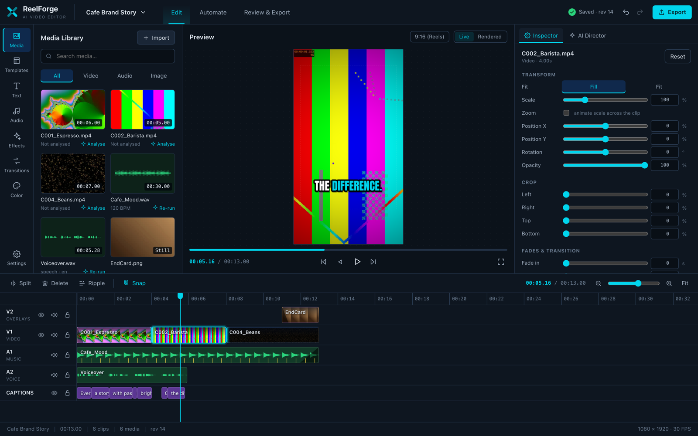
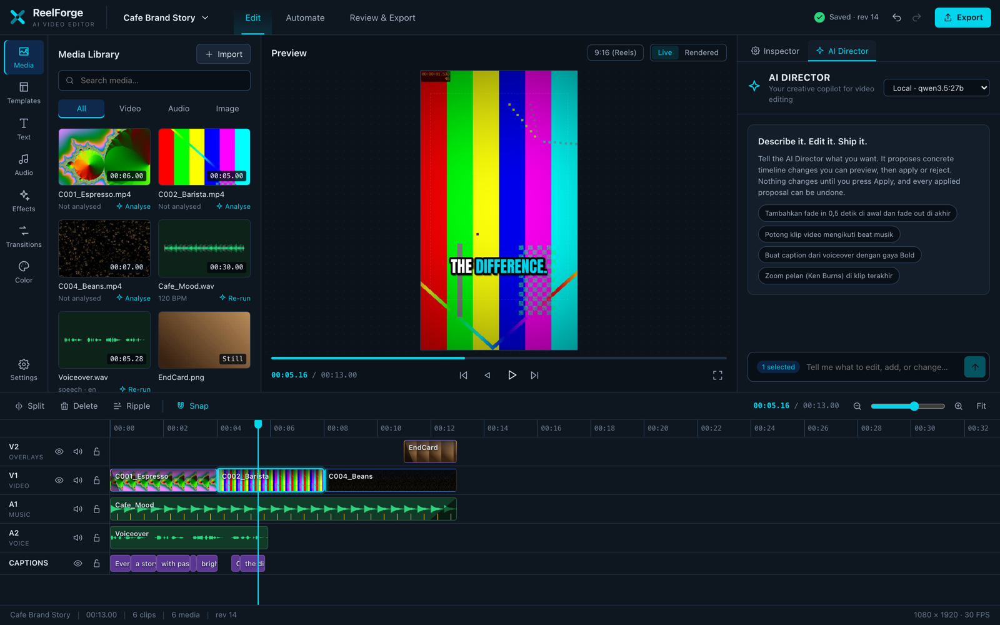
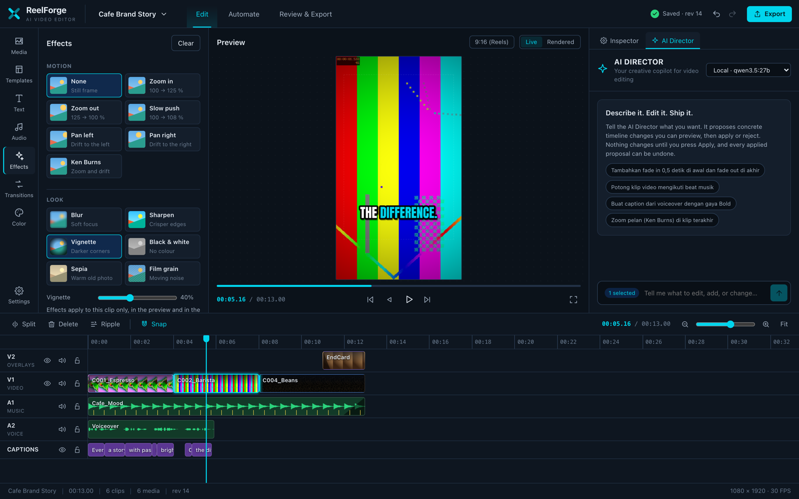
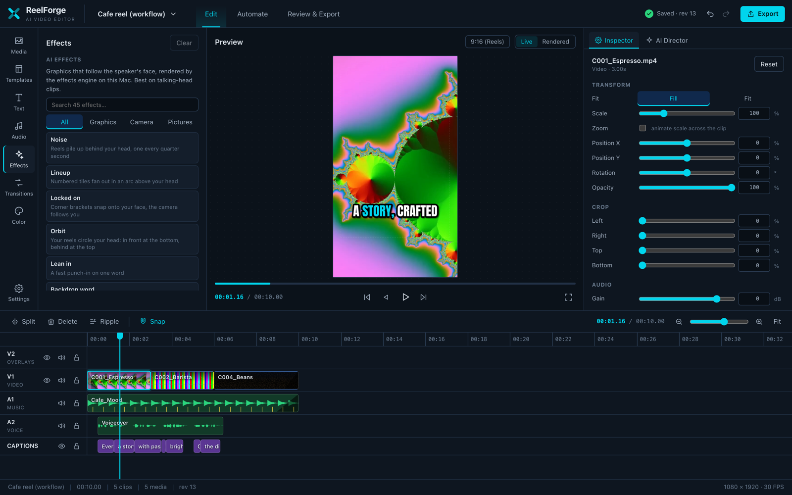
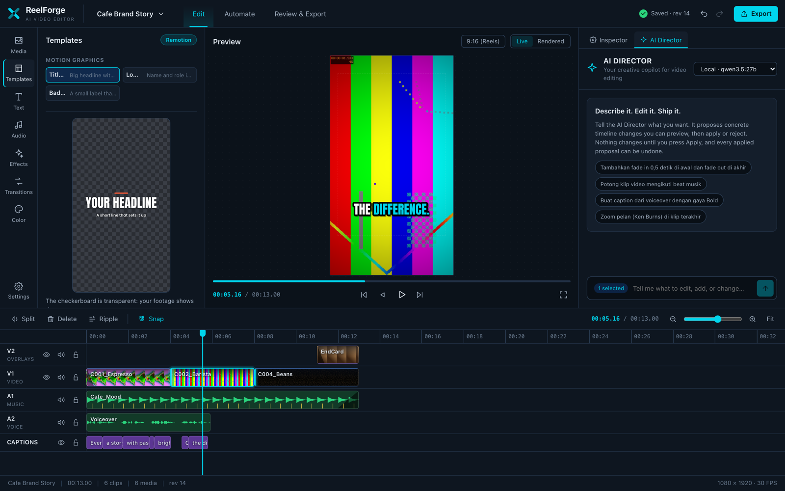
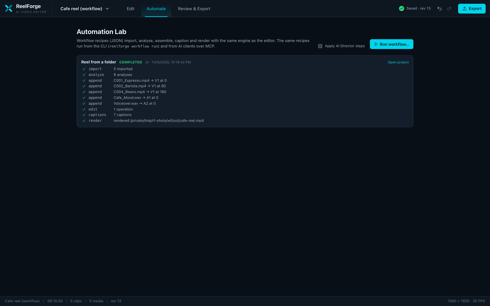
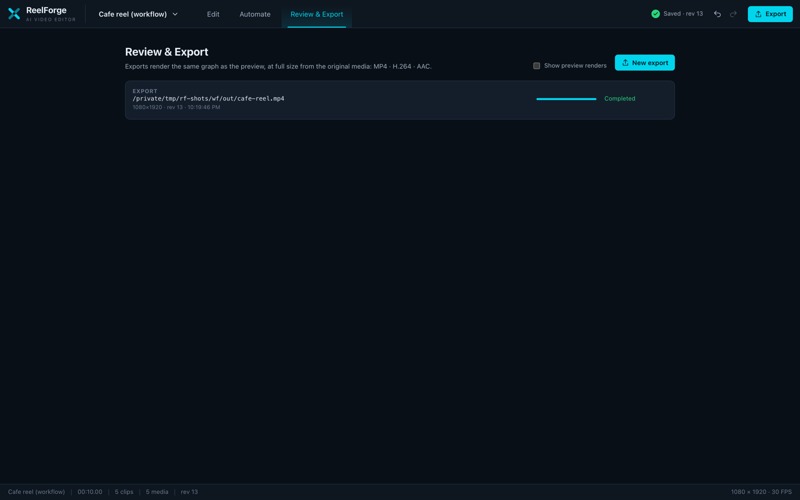

<p align="center"></p>

<h1 align="center">ReelForge</h1>
<p align="center"><strong>The open-source, AI-native video editor.</strong><br/>Describe it. Edit it. Ship it.</p>

<p align="center">
  <a href="LICENSE"></a>
  
  
</p>

<p align="center"></p>

ReelForge turns raw footage into editable, reviewable vertical (and horizontal) video. You can drive it from a
desktop studio, a built-in **AI Director**, any **MCP** client (Claude, ChatGPT, Gemini CLI) or a **JSON CLI**.
Every one of those goes through the same editing core, timeline model and project store, so an edit made by an AI
agent is the same kind of edit you make by hand: validated, revisioned and undoable.

- **Local-first.** Projects live in a SQLite workspace on your machine. No account, no upload.
- **Non-destructive.** Your original footage is only ever read, never modified.
- **Editable AI output.** AI produces timeline *proposals* you review and approve, never a flattened file.
- **Frame-exact.** Time is integer frames on a rational timebase (30000/1001, not 29.97).

> **Status: 0.1.0-alpha.1.** Usable end to end on macOS (Apple Silicon), but expect rough edges. See
> [CHANGELOG](CHANGELOG.md) and [docs/milestones.md](docs/milestones.md).

## Contents

- [Features](#features)
- [Screenshots](#screenshots)
- [Install](#install)
- [Build and run from source](#build-and-run-from-source)
- [Your first video (desktop)](#your-first-video-desktop)
- [AI Director: Claude or a local model](#ai-director-claude-or-a-local-model)
- [Command-line interface](#command-line-interface)
- [Use it from Claude, ChatGPT or Gemini CLI (MCP)](#use-it-from-claude-chatgpt-or-gemini-cli-mcp)
- [Workflow recipes](#workflow-recipes)
- [Motion graphics and the Remotion License](#motion-graphics-and-the-remotion-license)
- [Configuration](#configuration)
- [Troubleshooting](#troubleshooting)
- [Repository layout](#repository-layout)
- [Contributing](#contributing) · [Security](#security) · [License](#license)

## Features

| | |
|---|---|
| **Multi-track timeline** | Video, overlay, music, voice and caption tracks. Split, trim, move, ripple delete, snap, unlimited undo/redo. |
| **Live preview** | A canvas compositor over lightweight proxies with WebAudio, plus a *Rendered* mode that plays the real FFmpeg output. |
| **Frame-exact export** | MP4 (H.264/AAC, BT.709) at project size from the original media. Exports never overwrite an existing file. |
| **Media intelligence** | Local scene detection, music beat/BPM detection and speech transcription (whisper.cpp with voice activity detection). |
| **Animated captions** | Word-timed captions generated from your voice-over, with styles, editable on their own track, exportable as SRT. |
| **Effects** | Camera moves (zoom, push, pan, Ken Burns) and looks (blur, sharpen, vignette, black & white, sepia, film grain), identical in preview and export. |
| **AI effects** | 45 face-tracked effects (spotlight, giant word behind your head, lean-in, orbiting reels, glass widgets…) rendered locally. |
| **Motion graphics** | Title cards, lower thirds and badges from Remotion templates, rendered once into transparent clips. |
| **AI Director** | Tell it what you want in plain language (any language). It proposes concrete timeline changes; nothing changes until you press Apply. |
| **MCP server** | Let Claude Code, Claude Desktop, ChatGPT or Gemini CLI edit your projects, with every change gated by your approval. |
| **Workflow recipes** | Repeatable JSON pipelines: import → analyse → assemble → captions → AI pass → render. |

## Screenshots

| | |
|---|---|
|  |  |
| **AI Director**: describe the edit; review the proposal; apply or reject. | **Effects**: one-click camera moves and looks, each with an amount slider. |
|  |  |
| **AI effects**: 45 face-tracked effects, searchable by category. | **Templates**: motion graphics previewed live, rendered with transparency. |
|  |  |
| **Automation Lab**: every step of a workflow recipe run. | **Review & Export**: exports and preview renders with their progress. |

## Install

ReelForge currently runs on **macOS on Apple Silicon** (M1 or newer). It needs two media tools from
[Homebrew](https://brew.sh) that are not bundled:

```sh
brew install ffmpeg          # required: import, preview proxies, export
brew install whisper-cpp     # optional: transcription and captions
```

### Option A: the desktop app (DMG)

1. Download `ReelForge_<version>_aarch64.dmg` from the [Releases](../../releases) page and check its SHA-256
   against the one in the release notes: `shasum -a 256 ReelForge_*.dmg`.
   (No release is published yet? Build the DMG yourself; see [docs/releasing.md](docs/releasing.md).)
2. Open the DMG and drag **ReelForge** into **Applications**.
3. Alpha builds are **not signed by Apple**, so macOS blocks the first launch. Open it once, then go to
   **System Settings → Privacy & Security** and press **Open Anyway**. (Or run
   `xattr -dr com.apple.quarantine /Applications/ReelForge.app`. Only do this for a DMG you got from this project.)
4. For captions, download the speech models once (≈1.6 GB, verified by SHA-256). From a clone of this repository:

   ```sh
   ./scripts/download-models.sh
   ```

   They go to `~/Library/Application Support/ReelForge/models`.

The app bundles its own Node.js runtime, the AI effects engine (with its own Python) and the motion-graphics
renderer, so nothing else is needed.

### Option B: from source

See the next section. You get the CLI, the MCP server and the desktop app in development mode.

## Build and run from source

**Requirements**

| Tool | Version | Install |
|---|---|---|
| Node.js | ≥ 24 | `brew install node` or [nodejs.org](https://nodejs.org) |
| pnpm | 10 | `corepack enable` or `npm i -g pnpm` |
| FFmpeg | 7 or 8 | `brew install ffmpeg` |
| Rust (stable) | for the desktop shell only | [rustup.rs](https://rustup.rs) |
| whisper.cpp | optional, for captions | `brew install whisper-cpp` + `./scripts/download-models.sh` |
| Python 3.11/3.12 | optional, for AI effects | `brew install python@3.12` + `./scripts/setup-fx.sh` |

```sh
git clone https://github.com/ToingSeeker/reelforge.git
cd reelforge
pnpm install
pnpm check            # typecheck + the full test suite

pnpm desktop          # the desktop studio (Tauri dev window; starts the engine as a sidecar)
pnpm cli info         # or use the CLI: prints the workspace and database paths as JSON
```

The engine is TypeScript that runs directly on Node's type stripping, so there is no build step for it. Only the
desktop shell (Rust) compiles; the first `pnpm desktop` takes a few minutes.

To build the DMG yourself: `pnpm release:mac` (details in [docs/releasing.md](docs/releasing.md)).

## Your first video (desktop)

1. **Create a project.** Use the project menu at the top left → *New project*. The default is 1080×1920 at
   30 fps (Reels/TikTok/Shorts); pick another size and frame rate if you need one.
2. **Import media.** Drag files or a whole folder from Finder onto the window, or press **Import** in the Media
   Library. MP4, MOV, JPEG, PNG, WAV and MP3 work. ReelForge makes small preview proxies in the background; your
   originals are never touched.
3. **Analyse (optional).** Press **Analyse** on a card to detect scenes, the music's beats/BPM, or transcribe
   speech. Beats show as tick marks on the timeline that clips snap to.
4. **Assemble.** Drag clips onto the timeline: video on **V1**, logos and graphics on **V2 (overlays)**, music on
   **A1**, voice-over on **A2**. Use **Split**, **Delete**, **Ripple** and **Snap** in the timeline toolbar;
   `⌘Z` / `⇧⌘Z` undo and redo.
5. **Adjust a clip.** Select it and use the **Inspector** (fit/fill, scale, position, rotation, opacity, crop,
   fades, transitions, gain), the **Effects** rail (camera moves, looks, AI effects) or **Color**.
6. **Add captions.** Ask the AI Director *"make captions from the voice-over in Bold style"*, or use the **Text**
   rail. Captions are word-timed and editable on the Captions track.
7. **Add a motion graphic.** **Templates** rail → pick a title card, lower third or badge, fill in the fields, and
   press *Add at playhead*.
8. **Preview.** **Live** plays instantly from proxies; **Rendered** plays the real export pipeline at low
   resolution when you want to check the exact result.
9. **Export.** Press **Export** (top right), choose where to save, and follow progress in **Review & Export**.

Everything is saved as you go: each edit is a revision (`Saved · rev 14` in the header). Close the app at any
time; the project opens where you left it.

## AI Director: Claude or a local model

The AI Director (right-hand panel) turns a request like *"cut the B-roll on the beat and fade out the music"* into
a **proposal**: a list of concrete timeline operations you can inspect. Press **Apply** to make the change (one undo
step) or **Reject**. It can also use transcripts and beats, so *"put a spotlight on me when I say the price"* works
on word timing. Requests can be written in any language the model understands.

Pick a provider from the model menu at the top of the panel:

- **Local, with [Ollama](https://ollama.com)** (free, nothing leaves your Mac):

  ```sh
  brew install ollama && ollama serve
  ollama pull qwen2.5:14b          # or a larger model such as qwen3.5:27b for better plans
  ```

  ReelForge finds Ollama at `http://127.0.0.1:11434` (override with `REELFORGE_OLLAMA_URL`) and lists the models
  you have pulled.

- **Claude (Anthropic API):** open **Settings** (bottom left), paste your Anthropic API key, and save. The key is
  stored in the macOS Keychain and handed to the engine directly; it is never written to disk or logs. The first
  time you use Claude on a project, ReelForge asks for your consent to send that project's context (timeline,
  media names, transcripts) to Anthropic. You can revoke it at any time. From the CLI, set `ANTHROPIC_API_KEY`.

## Command-line interface

Every command prints exactly one JSON document, so the CLI is easy to script and to hand to an AI agent. From a
source checkout, run it as `pnpm cli …` (or `node packages/cli/bin/reelforge.js …`).

```sh
# Projects
pnpm cli project create --name "Cafe Brand Story"          # 1080×1920 @ 30 fps by default
pnpm cli project create --name "YouTube cut" --width 1920 --height 1080 --fps 29.97
pnpm cli project list
pnpm cli project rename <project> --name "Final" --base-revision 1
pnpm cli project history <project>
pnpm cli project delete <project> --yes                     # project data only; media files and exports stay

# Media and timeline (times: frames 90, seconds 2.5s, timecode 00:00:03:00 or 00:03.10)
pnpm cli media import <project> ~/Footage/*.mp4 ~/Music/track.wav
pnpm cli clip add <project> --track V1 --asset <asset> --start 0 --duration 4s
pnpm cli clip split <project> <clip> --at 2s
pnpm cli clip delete <project> <clip> --ripple
pnpm cli clip set <project> <clip> --props '{"fadeIn":15,"transitionIn":12,"scale":1.1,"scaleEnd":1.3,"vignette":0.4}'
pnpm cli timeline undo <project>
pnpm cli timeline get <project>

# Media intelligence and captions (all local)
pnpm cli media analyze <project> <asset> --kinds scenes,beats,transcript
pnpm cli captions generate <project> --source A2 --max-words 3 --language en
pnpm cli captions srt <project> --out captions.srt
pnpm cli project context <project>        # the structured view an AI planner reads

# AI Director: proposals you review and approve
pnpm cli ai providers
pnpm cli ai propose <project> "Fade in the first clip and cut the B-roll on the beat" --provider ollama
pnpm cli ai show <proposal>
pnpm cli ai apply <proposal> --yes        # your approval; never automatic
pnpm cli ai consent <project> --grant     # before using Claude (needs ANTHROPIC_API_KEY)

# Render (preview and export use the same graph; exports never overwrite)
pnpm cli preview <project>
pnpm cli render <project> --out ~/Movies/reel.mp4
pnpm cli jobs list <project>
```

Run `pnpm cli --help` for the full list. Exit codes: `0` ok, `1` internal, `2` invalid input, `3` not found,
`4` revision conflict, `6` a dependency (FFmpeg, whisper.cpp…) is unavailable.

The CLI and the desktop app share the same workspace: rename a project from the CLI while the app is open and the
window updates within about two seconds.

## Use it from Claude, ChatGPT or Gemini CLI (MCP)

ReelForge ships a local MCP server over stdio. External AI clients can create projects, import and analyse media,
read the timeline, propose edits and render. **Every timeline change is a proposal you approve**: the client asks
you (MCP elicitation), or you press Apply in ReelForge, or you run `reelforge ai apply <id> --yes`.

```sh
# Claude Code, from a source checkout
claude mcp add reelforge -- node /path/to/reelforge/packages/cli/bin/reelforge.js mcp

# Claude Code, using the installed app's own engine (no repository needed)
claude mcp add reelforge -- /Applications/ReelForge.app/Contents/Resources/engine/node /Applications/ReelForge.app/Contents/Resources/engine/reelforge.mjs mcp
```

Claude Desktop and other clients (`mcpServers` config):

```json
{ "mcpServers": { "reelforge": { "command": "node", "args": ["/path/to/reelforge/packages/cli/bin/reelforge.js", "mcp"] } } }
```

Then just ask, for example: *"Make a 15-second reel from the clips in ~/Footage/cafe, cut on the beat of
Cafe_Mood.wav, add bold captions from the voice-over and render it to ~/Movies."*

Tools: `projects_list|create|get`, `media_import|analyze|get_analysis`, `audio_detect_beats`, `timeline_get`,
`timeline_propose_edit|get_proposal|apply_proposal|undo`, `captions_generate`, `preview_create`, `render_start`,
`jobs_get|cancel`, `outputs_get`, `workflows_run|runs`.

### Claude.ai and ChatGPT (remote connector)

The web and mobile apps of Claude and ChatGPT can't start a local process. They need a remote MCP server on a
public https URL. ReelForge runs one on your machine, behind an [ngrok](https://ngrok.com) tunnel. Once, install
ngrok and add your (free) token: `brew install ngrok && ngrok config add-authtoken <your-token>`.

**From the app:** open Settings (gear, bottom left) → Claude & ChatGPT → Start. It shows the connector link and an
access key, each with a Copy button. The connector starts again with the app until you press Stop. Under Tunnel
options you can set a reserved ngrok domain, so the link stays the same, or use a tunnel you run yourself.

**From a terminal:**

```sh
reelforge connector --tunnel ngrok           # prints the connector URL and the access key
```

Add the `…/mcp` link as a custom connector. In Claude, go to Settings → Connectors → Add custom connector.
In ChatGPT, go to Settings → Apps & Connectors → Advanced → Developer mode, then create a connector. When the app
opens the ReelForge sign-in page, enter the access key. The key stays the same until you press New key; apps
already connected keep working when you do. The connection lasts 60 days. Keep ReelForge (or the command) running
while you chat.

How it differs from the local server:

- **Sending video.** In ChatGPT, attach the file in the chat and the AI adds it with `media_add_file`. Claude
  can't pass attachments to a connector, so it gives you a one-time upload link (`media_upload_link`) to open in
  your browser. Both can also take a public https link (`media_add_from_url`). Files are stored in
  ReelForge's folder on your computer.
- **Approving edits.** `timeline_apply_proposal` returns an approval link. Open it, review the changes, and
  press Apply. The page only applies an edit from the browser that entered the access key, or when the code is
  typed again. The AI can hold the link, but it can't approve its own edit.
- **Getting the video back.** `render_start` writes to ReelForge's exports folder (`--out <dir>` changes it).
  When the job completes, `jobs_get` gives a download link valid for 24 hours.
- **What's not offered.** Local file paths (`media_import`) and `workflows_run` aren't available, so a remote
  client can't read other files on your computer. Downloads from links are https only and never go to local or
  private network addresses.

`reelforge connector status` lists the connected apps. `reelforge connector revoke` disconnects all of them;
restart the connector afterwards. To use your own tunnel instead of ngrok, pass
`--public-url https://your.domain`.

## Workflow recipes

A recipe is a JSON file that runs the whole pipeline the same way every time, from the CLI, from the
**Automate** tab (*Run workflow…*) or from an MCP client:

```json
{
  "version": 1,
  "name": "Reel from a folder",
  "project": { "name": "Cafe reel (workflow)", "width": 1080, "height": 1920, "fps": "30" },
  "steps": [
    { "import": { "paths": ["footage/*.mp4", "music/*.wav", "voice/*.wav"] } },
    { "analyze": { "kinds": ["beats", "transcript"] } },
    { "append": { "asset": "C001_Espresso.mp4", "track": "V1", "duration": "3s", "props": { "fadeIn": 15 } } },
    { "append": { "asset": "Cafe_Mood.wav", "track": "A1", "duration": "10s", "props": { "gainDb": -10, "fadeOut": 30 } } },
    { "append": { "asset": "Voiceover.wav", "track": "A2" } },
    { "captions": { "source": ["A2"], "maxWords": 3, "style": "bold" } },
    { "render": { "out": "out/cafe-reel.mp4" } }
  ]
}
```

```sh
pnpm cli workflow validate recipe.json
pnpm cli workflow run recipe.json                 # AI Director steps stay proposals…
pnpm cli workflow run recipe.json --approve-ai    # …unless you approve them up front
```

Paths are relative to the recipe file. More in [examples/workflows](examples/workflows/README.md).

## Motion graphics and the Remotion License

The **Templates** panel makes motion graphics (title cards, lower thirds, badges) with
[Remotion](https://www.remotion.dev). You preview a template live, and the engine renders it once on your Mac into
a transparent clip (ProRes 4444) that goes on the overlay track like any other media.

Remotion is **source-available, not open source**. It ships inside the ReelForge app, and its own license applies
to it ([Remotion License](https://www.remotion.dev/license)):

- **Free** for individuals, non-profits and companies of **up to 3 people**.
- A **company license from Remotion is required** for for-profit organisations of 4 or more. That includes using
  ReelForge's motion graphics at such a company.

Everything else in ReelForge stays Apache-2.0. The app also ships the Chrome Headless Shell that Remotion draws
frames with (about 170 MB of the download). Templates live in `packages/motion`. When running from source, the
first motion render bundles the templates and Remotion fetches its headless browser.

## Configuration

| Variable | What it does |
|---|---|
| `REELFORGE_HOME` (or `--home <dir>`) | Workspace directory. Default `~/Library/Application Support/ReelForge` (database `reelforge.db`, `cache/`). |
| `REELFORGE_MODELS` | Where the whisper/VAD models live (default: `models/` in the app-data folder; ignores `REELFORGE_HOME`). |
| `REELFORGE_FFMPEG`, `REELFORGE_FFPROBE` | Use a specific FFmpeg/FFprobe binary instead of the one on `PATH`. |
| `REELFORGE_WHISPER` | Use a specific `whisper-cli` binary. |
| `REELFORGE_OLLAMA_URL` | Ollama endpoint (default `http://127.0.0.1:11434`). A non-local host counts as an external provider and needs consent. |
| `ANTHROPIC_API_KEY` | Claude key for the CLI/MCP (the desktop app uses the Keychain instead). |
| `REELFORGE_FX_PYTHON` | Python for AI effects when running from source (default: the venv made by `scripts/setup-fx.sh`). |
| `REELFORGE_DEBUG=1` | Log the engine's HTTP requests to stderr. |

## Troubleshooting

- **"ReelForge can't be opened" / "unidentified developer"**: expected for unsigned alpha builds; see
  [Install](#option-a-the-desktop-app-dmg) step 3.
- **Import fails or the engine reports FFmpeg missing** (exit code `6`): `brew install ffmpeg`. The app also looks
  in `/opt/homebrew/bin` and `/usr/local/bin` when launched from Finder.
- **Captions or transcripts are unavailable**: install `whisper-cpp` and run `./scripts/download-models.sh`.
- **AI effects say the engine isn't set up** (from source): run `./scripts/setup-fx.sh` (needs Python 3.11/3.12).
- **AI Director lists no models**: start Ollama (`ollama serve`) and pull a model, or add a Claude key in Settings.
- **Claude fails behind a corporate proxy**: the release app strips `NODE_*` variables (including
  `NODE_EXTRA_CA_CERTS`) from the engine, so a custom CA is not picked up. Use the CLI with your environment, or a
  local model.
- **Browser-only UI development**: run `REELFORGE_API_TOKEN=<32+ chars> pnpm cli serve --allow-origin
  http://localhost:5173` and start Vite in `apps/desktop` with `VITE_REELFORGE_API_URL` and
  `VITE_REELFORGE_API_TOKEN` set.

## Repository layout

```
packages/core        editing core: schemas, rational timebase, timeline reducer, SQLite stores, undo
packages/media       FFprobe/FFmpeg: import, probing, proxies, thumbnails, waveforms, render, captions
packages/server      local REST API (loopback only, bearer token, Host/Origin checks)
packages/ai          AI Director: Claude + Ollama adapters, proposal planner
packages/automation  workflow recipe (JSON) runner
packages/mcp         MCP server (stdio) and the remote connector (HTTPS + OAuth) over the same engine
packages/cli         `reelforge` JSON CLI, including `reelforge serve` and `reelforge mcp`
packages/motion      motion-graphics templates (Remotion compositions) and their render process
packages/fx-engine   AI effects engine (Python, MediaPipe), vendored from claude-video-effects (MIT)
apps/desktop         Tauri 2 + React studio; the Rust shell runs the engine as a sidecar
docs/                PRD, architecture, milestones, releasing, design reference
```

Architecture notes: [docs/architecture.md](docs/architecture.md) · Full specification: [docs/PRD.md](docs/PRD.md)

## Contributing

Contributions are welcome! Please read [CONTRIBUTING.md](CONTRIBUTING.md) and the
[Code of Conduct](CODE_OF_CONDUCT.md). In short: every feature goes through `packages/core`, every mutation is a
revisioned operation, time is in frames, originals are read-only, and `pnpm check` must pass.

## Security

Please report vulnerabilities privately as described in [SECURITY.md](SECURITY.md), not in public issues.

## License

[Apache-2.0](LICENSE). Third-party components keep their own licenses: FFmpeg; whisper.cpp (MIT) and its models;
the AI effects engine claude-video-effects by Vibha Ramprakash (MIT, `packages/fx-engine/LICENSE`); the caption
fonts Anton and Poppins (SIL Open Font License, texts in `assets/fonts/`); opentype.js (MIT). Remotion is under the
Remotion License (see [Motion graphics](#motion-graphics-and-the-remotion-license)). The full list of what a release
ships is generated into `THIRD_PARTY_NOTICES.txt`.
